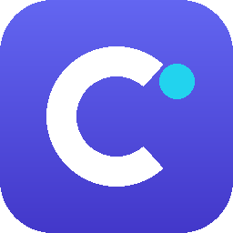

<h3 align="center"></h3>
<h3 align="center">Constructor — Build Apps and Websites With AI</h3>

<p align="center">
    <a href="https://salim-studio.github.io/constructor/"><strong>« LIVE DEMO »</strong></a>
    <br />
    <br />
    <a href="https://salim-studio.github.io/constructor/">Live Demo</a>
    ·
    <a href="https://github.com/salim-studio/constructor">GitHub</a>
    ·
    <a href="https://github.com/salim-studio/constructor/issues">Issues</a>
</p>

<br>

## Constructor

Describe what you want in plain language and Constructor turns it into a working website or application — no code required. An open-source AI app builder: chat with the assistant, watch a live preview take shape, edit visually, and publish to a real URL.

Constructor runs entirely in the browser and is powered by **Salim Slimani AI** — an internal, flexible AI engine and virtual filesystem that allows building apps and websites directly in your browser without cloud balance limits or third-party paid subscriptions.

<br>

## Features

Go from an idea to a working website or application in your browser. Constructor brings creation, editing, and publishing together in one place.

- **Build with AI:** Describe what you want in plain language and turn it into a website or application, without coding or any technical knowledge.
- **Secure and scalable apps:** Your apps run securely and scale effortlessly without requiring you to manage infrastructure or API keys.
- **Batteries included:** Authentication, storage, databases, AI, networking, realtime capabilities, and serverless functions.
- **Publish and share:** Publish your project to a public URL when you're ready to share it with the world.
- **Live preview:** See your project take shape and try it out as you make changes.
- **Chat and visual editing:** Ask for changes in chat or select an element in the preview to say exactly what to update.
- **Version history:** Revisit saved versions and restore an earlier state as you experiment.
- **MCP connections:** Connect remote MCP servers so the AI can use tools from your other services while it builds.
- **Templates:** Start from a finished app or website and make it yours by describing changes.

Follow the steps below to start building your first website or app.

<br>

## Getting Started

### 💻 Installation

```bash
git clone https://github.com/salim-studio/constructor
cd constructor
npm install
npm run dev
```

<br>

### 🌐 Live Demo

Try Constructor live at [https://salim-studio.github.io/constructor/](https://salim-studio.github.io/constructor/).

<br>

## Support

- Bug report or feature request? Please [open an issue](https://github.com/salim-studio/constructor/issues/new).

<br/>

## License

This project is licensed under [Apache License 2.0](LICENSE) unless explicitly stated otherwise. It is a rebranded fork of [HeyPuter/builder](https://github.com/HeyPuter/builder), which is also Apache-2.0 licensed; the original copyright and license notices are preserved. Bundled third-party libraries and fonts retain their own licenses; see [Third-party notices](THIRD_PARTY_NOTICES.md).

<br/>

© 2026 salim-slimani. All rights reserved.
